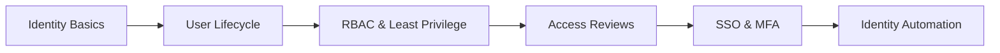

👨‍💻 About Me
I am Vilas Sonawane, an aspiring Identity and Access Management (IAM) Engineer focused on developing practical skills in SailPoint IdentityIQ, Identity Governance and Administration (IGA), Microsoft Entra ID, and user lifecycle management.
- 🔐 Exploring Joiner–Mover–Leaver (JML) workflows and identity provisioning
- 🧩 Learning RBAC, least privilege, access reviews, and account aggregation
- ☁️ Building hands-on labs with Microsoft Entra ID (Azure AD)
- 💻 Working with Java, SQL, CSV integrations, and IAM concepts
- 🎯 Goal: Build a strong portfolio of documented, reproducible IAM projects
🛠️ Technologies & Tools

🚀 Featured Projects
🔹 SailPoint IdentityIQ – Flat File Onboarding
A hands-on SailPoint IdentityIQ project using a CSV-based HR source, Delimited File Application, and account aggregation.

🔹 Microsoft Entra ID – User Lifecycle Management (Lab in progress)
An IAM lab covering Joiner, Mover, and Leaver workflows, department-based security groups, provisioning, deprovisioning, and verification evidence. Repository link will be added after the lab is completed and published.
🗺️ IAM Learning Roadmap

📊 GitHub Activity

Note: GitHub activity cards and animations use third-party image services. If one is unavailable, that specific image may not render; the rest of the README will still work.

📫 Connect
- 🌐 GitHub Profile
- 📍 Maharashtra, India

⭐ Learning by building real IAM labs and documenting each step.

