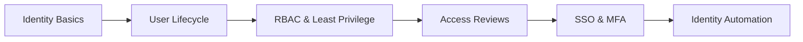

## 👨‍💻 About Me

I am **Vilas Sonawane**, an aspiring **Identity and Access Management (IAM) Engineer** focused on developing practical skills in **SailPoint IdentityIQ, Identity Governance and Administration (IGA), Microsoft Entra ID, and user lifecycle management**.

- 🔐 Exploring **Joiner–Mover–Leaver (JML)** workflows and identity provisioning
- 🧩 Learning **RBAC, least privilege, access reviews, and account aggregation**
- ☁️ Building hands-on labs with **Microsoft Entra ID (Azure AD)**
- 💻 Working with **Java, SQL, CSV integrations**, and IAM concepts
- 🎯 Goal: Build a strong portfolio of documented, reproducible IAM projects

## 🛠️ Technologies & Tools

  

## 🚀 Featured Projects

### 🔹 SailPoint IdentityIQ – Flat File Onboarding

A hands-on SailPoint IdentityIQ project using a CSV-based HR source, Delimited File Application, and account aggregation.

### 🔹 Microsoft Entra ID – User Lifecycle Management *(Lab in progress)*

An IAM lab covering **Joiner, Mover, and Leaver** workflows, department-based security groups, provisioning, deprovisioning, and verification evidence. Repository link will be added after the lab is completed and published.

## 🗺️ IAM Learning Roadmap

## 📊 GitHub Activity

> **Note:** GitHub activity cards and animations use third-party image services. If one is unavailable, that specific image may not render; the rest of the README will still work.

## 📫 Connect

- 🌐 [GitHub Profile](https://github.com/vilassonawaneit-wq)
- 📍 Maharashtra, India

⭐ *Learning by building real IAM labs and documenting each step.*

