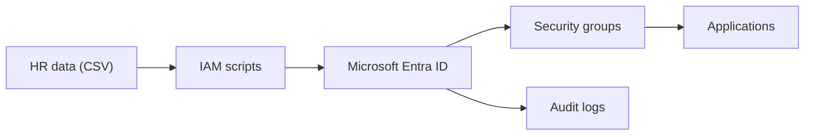
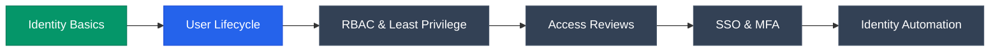

 

---

## 👨‍💻 About Me

I'm **Vilas Sonawane**, an aspiring **Identity and Access Management (IAM) Engineer** from Maharashtra, India. I learn by **building hands-on labs** and documenting every step so that anyone can reproduce them.

| | |
|---|---|
| 🎯 **Goal** | Start my career as an IAM Engineer / IAM Analyst |
| 🔭 **Currently building** | Microsoft Entra ID – User Lifecycle Management lab (Joiner • Mover • Leaver) |
| 🌱 **Currently learning** | SailPoint IdentityIQ, Identity Governance (IGA), RBAC, access reviews |
| 📂 **What you'll find here** | Documented, reproducible IAM projects with diagrams, scripts and test evidence |

---

## 🛠️ Technologies & Tools

| Area | Skills |
|---|---|
| 🔐 **Identity & Access** | Joiner–Mover–Leaver (JML), provisioning / deprovisioning, RBAC, least privilege |
| 🧩 **IGA** | SailPoint IdentityIQ, account aggregation, flat-file (CSV) integrations, access reviews |
| ☁️ **Cloud identity** | Microsoft Entra ID (Azure AD), security groups |
| 💻 **Programming & Data** | Java, SQL, CSV |
| 🧰 **Tools** | Git, GitHub, VS Code, Windows, Linux |

---

## 🚀 Featured Projects

| # | Project | Focus | Status |
|:-:|---|---|:-:|
| 1 | **[SailPoint IIQ – Flat File Onboarding](https://github.com/vilassonawaneit-wq/SailPoint-IIQ-Flat-File-Onboarding)** | CSV HR source, Delimited File application, account aggregation | ✅ Published |
| 2 | **[Microsoft Entra ID – User Lifecycle Management](https://github.com/vilassonawaneit-wq/iam-user-lifecycle-management)** | Joiner / Mover / Leaver, department-based groups, automation scripts, audit evidence | 🔨 In progress |

<b>🔹 Project 1 – SailPoint IdentityIQ: Flat File Onboarding</b>

 

A hands-on SailPoint IdentityIQ project that uses a CSV-based HR source, a Delimited File Application and account aggregation to bring identities into IdentityIQ.

<b>🔹 Project 2 – Microsoft Entra ID: User Lifecycle Management</b>

 

An IAM lab that simulates the full user lifecycle: onboarding new hires, updating access when people change roles, and fully revoking access when they leave.

- ✔️ Department-based security groups (no direct user-to-app assignments)
- ✔️ Joiner, Mover and Leaver process diagrams and SOPs
- ✔️ PowerShell (Microsoft Graph) automation + Python offline simulator
- ✔️ Test cases and audit-log evidence

---

## 🗺️ IAM Learning Roadmap

🟩 Done &nbsp; 🟦 In progress &nbsp; ⬜ Planned

---

## 📊 GitHub Activity

> **Note:** this card uses a third-party image service. If it is temporarily unavailable, only that image will not render.

---

## 📫 Connect With Me

<!-- Add your LinkedIn link below, then remove this comment:

-->

📍 Maharashtra, India

 

⭐ *Learning by building real IAM labs and documenting each step.*

